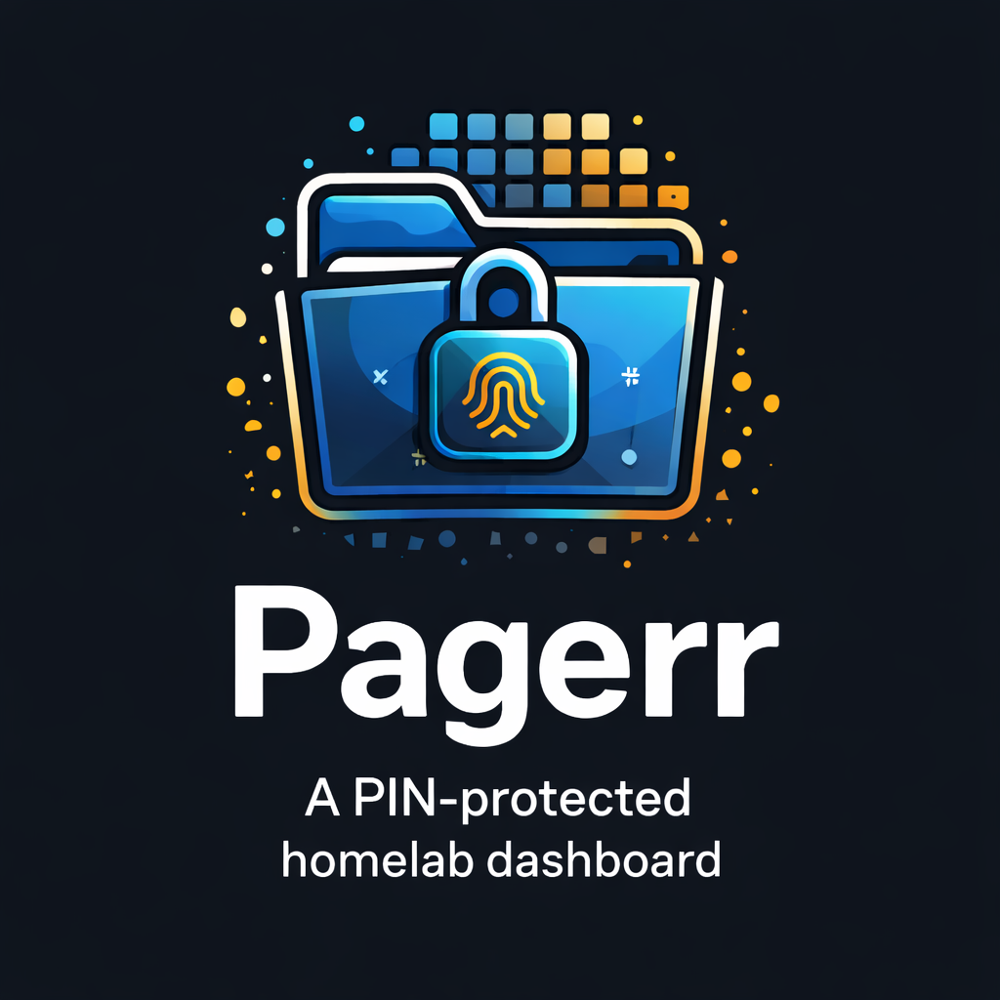
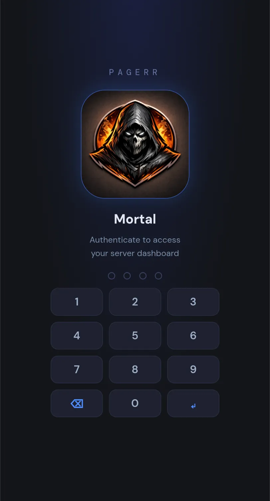
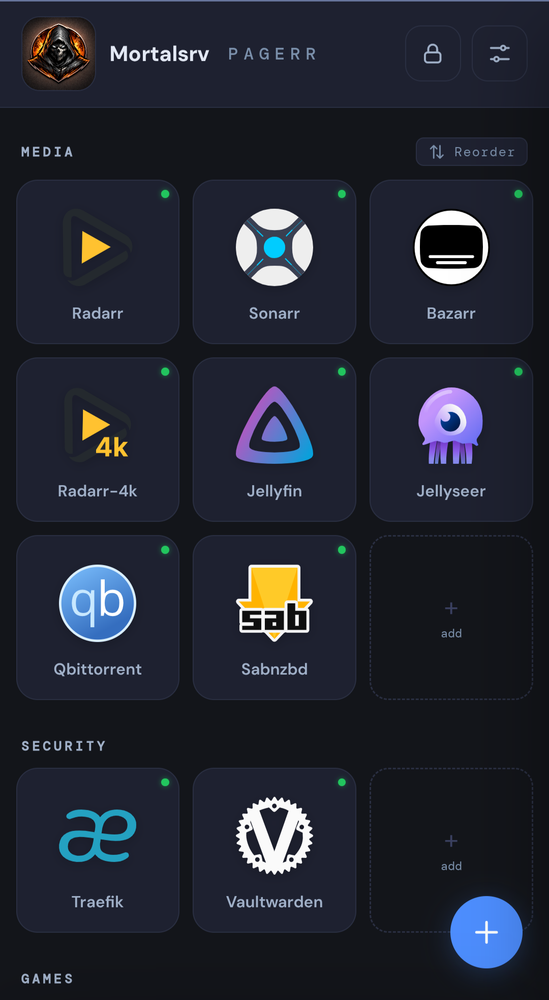
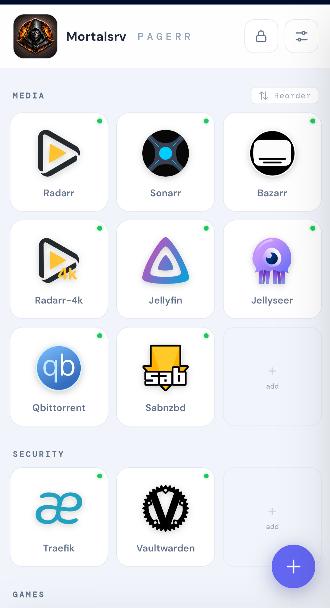
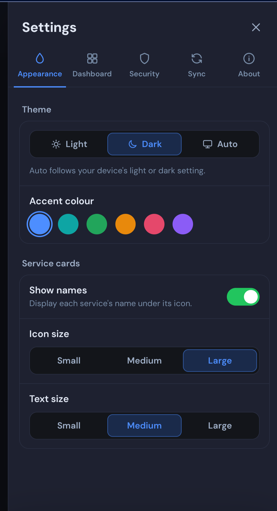

<div align="center">



# Pagerr

**A PIN-protected, single-file homelab dashboard.**


Pagerr is a single HTML file that gives you a clean, mobile-first dashboard for all your self-hosted services. No database. No backend. No accounts. Everything lives in your browser's `localStorage`.

Built for Tailscale. Works behind any reverse proxy.

</div>

---

## Screenshots

| Lock Screen | Dashboard (Dark) | Dashboard (Light) | Settings |
|:-----------:|:----------------:|:-----------------:|:--------:|
|  |  |  |  |

---

## Features

- **Single file** — the entire app is one `.html` file. Serve it anywhere
- **PIN lock** — 4–6 digit PIN set on first launch, with optional biometric unlock
- **Secure PIN hashing** — PIN hashed with PBKDF2 (100,000 iterations, SHA-256) using a random per-install salt. Never stored in plain text
- **PIN brute-force lockout** — 5 failed attempts triggers a lockout with exponential backoff, up to 30 minutes
- **Auto icon matching** — fetches service icons automatically from [dashboard-icons](https://github.com/homarr-labs/dashboard-icons)
- **Service status dots** — live green/red indicator on each card showing if the service is reachable
- **Categories** — organise services into labelled groups
- **Reorder** — tap Reorder (or use Settings → Dashboard) to rearrange services and swap across categories
- **Copy-paste sync** — generate an encrypted sync code on one device and paste it on another. No files, no cloud, no accounts
- **Encrypted JSON backup** — export and import your full config with password protection
- **Light, dark or auto theme** — Auto follows your device and switches live
- **Accent colours** — six colours that recolour buttons, toggles and highlights
- **Tabbed settings** — Appearance, Dashboard, Security, Sync and About, with a consistent SVG icon set
- **Fast icons** — icons are downloaded once and cached in your browser, so unlocking and reloading are instant (and work offline)
- **Customisable display** — icon size, text size, toggleable service names
- **Custom branding** — upload your own server logo and name
- **Add to home screen** — installs as a PWA on mobile for a full-screen app experience
- **Zero tracking** — nothing leaves your device

---

## Quickstart

```bash
docker run -d -p 10000:80 --name pagerr mortaljinx/pagerr:latest
```

Or with Docker Compose:

```bash
git clone https://github.com/mortaljinx/pagerr.git
cd pagerr
docker compose up -d
```

Open `http://your-server-ip:10000` — or your Tailscale IP if accessing remotely.

On first launch you'll set a PIN and optionally a server name and logo.

---

## Docker Compose

```yaml
services:
  pagerr:
    image: mortaljinx/pagerr:latest
    container_name: pagerr
    ports:
      - "10000:80"
    security_opt:
      - no-new-privileges:true
    restart: unless-stopped
    logging:
      driver: json-file
      options:
        max-size: "10m"
        max-file: "3"
```

---

## Updating

```bash
docker pull mortaljinx/pagerr:latest
docker compose down && docker compose up -d
```

Your data lives in `localStorage` in your browser — updating never touches your services or settings.

If you mount your own `index.html` into the container, run `docker restart pagerr` after replacing the file so the container picks up the new copy.

---

## Sync Between Devices

Settings → **Sync** → enter a passphrase → **Generate Sync Code**.

A code starting with `PAGERR2:` (HTTPS) or `PAGERR2X:` (HTTP) will appear. Copy it — paste it anywhere: iMessage, Notes, Signal, email. A `PAGERR2:` (AES) code can only be imported on an HTTPS address; a `PAGERR2X:` code imports anywhere. When syncing between plain-HTTP addresses, generate and import on HTTP on both sides. Sync codes don't include your server logo — upload it on each device.

On the other device: Settings → **Sync** → paste the code → enter the same passphrase → **Import from Code**.

The sync code contains your entire config — services, categories, settings, server name and logo — encrypted with your passphrase.

> PIN and biometric are not synced. Set those fresh on each device.

---

## Backup & Restore

Settings → **Backup** → **Export JSON** prompts for a password and downloads an encrypted `pagerr-config.json`.

To restore: Settings → **Backup** → **Import JSON** → pick the file → enter the password.

**Encryption method depends on how Pagerr is served:**

| Protocol | Method |
|---|---|
| HTTPS | AES-256-GCM with PBKDF2 key derivation |
| HTTP | Password-based obfuscation |

For full AES-256 encryption, serve Pagerr over HTTPS using a reverse proxy, or via Tailscale HTTPS.

---

## Access Methods

### Tailscale (recommended)

Run Pagerr on your server and access it from any device on your tailnet without opening any ports.

```
http://your-tailscale-ip:10000
```

### Reverse Proxy

Pagerr works behind Traefik, Caddy, Nginx Proxy Manager, or any other proxy. Point it at the container port and you're done. Using HTTPS here also unlocks AES-256 encryption for exports and sync.

---

## Install as Home Screen App

Pagerr works as a PWA — add it to your phone home screen for a full-screen, app-like experience.

**iOS (Safari):** Share → Add to Home Screen

**Android (Chrome):** Menu → Add to Home Screen / Install App

---

## Browser Compatibility

| Feature | Chrome | Firefox | Safari | Edge |
|---|---|---|---|---|
| PIN lock | ✅ | ✅ | ✅ | ✅ |
| Biometric unlock | ⚠️ | ✅ | ⚠️ | ⚠️ |
| Add to home screen | ✅ | ✅ | ✅ | ✅ |
| AES-256 export / sync | ✅ HTTPS only | ✅ HTTPS only | ✅ HTTPS only | ✅ HTTPS only |
| PBKDF2 PIN hashing | ✅ | ✅ | ✅ | ✅ |

Biometric support outside Firefox depends on your OS and browser version. PIN is always available as a fallback.

---

## Security Notes

Pagerr is a convenience lock for a private dashboard, **not** a replacement for network-level protection. Read the model below so you know what the PIN does and doesn't protect.

### What the PIN protects
- The PIN screen keeps casual access out — someone picking up an unlocked phone, a family member, a guest on your LAN
- The PIN is hashed with PBKDF2-HMAC-SHA256 (100,000 iterations) and a **random per-install salt**. It is never stored in plain text — on HTTPS it uses the browser's Web Crypto, on plain HTTP a built-in implementation produces the identical hash
- 5 wrong PINs triggers a lockout with exponential backoff (up to 30 minutes); changing the PIN requires the current one

### What it does not protect
- The lock runs in the browser. Anyone who can open your browser's developer tools on that device can read the stored dashboard data (service names and URLs) or bypass the lock screen
- A 4–6 digit PIN can be brute-forced offline by someone who has copied your browser storage
- **Put real protection in front of Pagerr:** Tailscale (recommended), or a reverse proxy with authentication (Authelia, Authentik, basic auth). Don't expose Pagerr directly to the internet

### Data handling
- All data is stored in your browser's `localStorage` — nothing is sent to any server of ours or logged
- No service credentials are stored. Cards open the service directly and your browser remembers the login
- Sync codes and encrypted backups use AES-256-GCM over HTTPS. On plain HTTP they are only password-**obfuscated** (XOR) — treat those as casual protection and prefer HTTPS for anything sensitive
- Sync codes and imports are validated: only `http://` and `https://` service URLs are accepted and all text is escaped, so a malicious file cannot run script. Only import files and codes you created yourself

### Third-party requests
Icons are downloaded once and then served from a cache in your browser, so these requests happen only for new or refreshed icons. To show icons and fonts, the page fetches from `fonts.googleapis.com`, `cdn.jsdelivr.net`, `raw.githubusercontent.com` and `www.google.com` (favicon fallback). These requests reveal your IP address and which well-known app icons are shown — never your own URLs or login details. Custom icon URLs you enter are fetched from wherever you point them.

### Hardening your deployment
- Serve over HTTPS (Tailscale does this automatically; with a reverse proxy, terminate TLS there and add HSTS)
- The bundled nginx config sends a strict Content Security Policy, `Referrer-Policy: no-referrer`, `Permissions-Policy`, and hides the server version
- The compose file runs with `no-new-privileges` and capped logs
- Found a vulnerability? Please open a private security advisory on the GitHub repository rather than a public issue

---

## Personal Project

Pagerr is a personal project. It is shared publicly for anyone who finds it useful but is **not actively maintained as an open source project**. Issues and pull requests are not monitored.

If it works for you, great. If something is broken, feel free to fork it.

---

## License

MIT — see [LICENSE](LICENSE) for details.

---

*Built for homelabbers, by a homelabber.*
